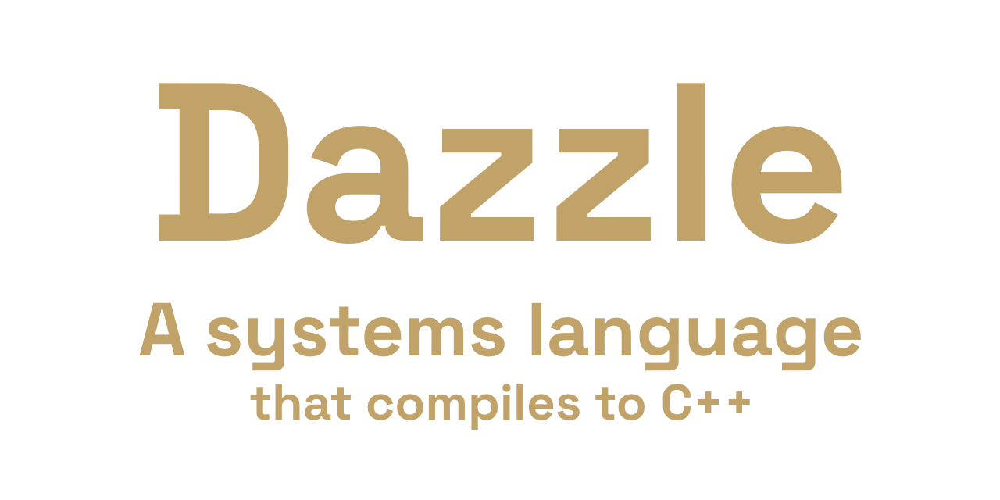
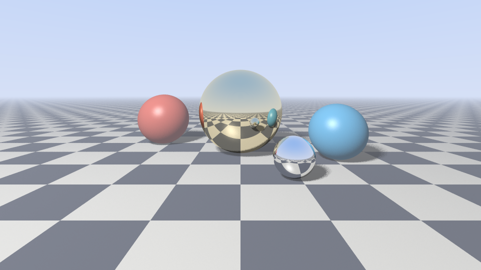
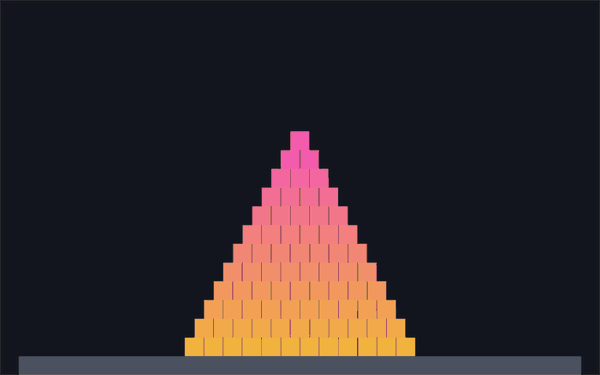

<p align="center">
  
</p>

<p align="center">
  <strong>Memory-safe systems programming without a garbage collector or Rust-style borrowing restrictions.</strong>
</p>

<p align="center">
  <a href="https://dazzle-lang.github.io/playground/?example=order-reference">Try Dazzle in your browser</a> ·
  <a href="https://dazzle-lang.github.io/tour/overview/">Take the tour</a> ·
  <a href="#quick-start">Get started</a> ·
  <a href="https://dazzle-lang.github.io/spec/">Language specification</a>
</p>

Dazzle is a systems programming language for games, engines, and native software.
It checks references for invalidation, chooses where memory is allocated, and
compiles to C++17. You can use existing C and C++ libraries without writing
bindings or adopting a new native toolchain.

## Why Dazzle?

- **Safe references, without a borrow checker.** Dazzle checks which operations
  can invalidate a reference, instead of forbidding otherwise-safe aliasing.
- **Memory placement without allocator plumbing.** No garbage collector and no
  allocator arguments in ordinary code. The compiler chooses where allocations
  live; scope and ownership determine when memory is released.
- **Direct C and C++ interoperability.** Use libraries from their headers,
  including C++ classes and supported template instances, without writing a
  wrapper layer.
- **Existing C++ toolchains.** Dazzle emits standard C++17, so native compilers,
  linkers, debuggers, and profilers remain part of the workflow.

## See Dazzle in action

Dazzle's examples use native graphics, physics, and audio libraries.

<p align="center">
  <a href="examples/sdl3"></a>
  <a href="examples/stb"></a>
</p>
<p align="center">
  <a href="examples/sdl3">3D scene · SDL3 + Dear ImGui</a> &nbsp; · &nbsp;
  <a href="examples/stb">Ray tracer · stb</a>
</p>
<p align="center">
  <a href="examples/box2d"></a>
  <a href="examples/sokol"></a>
</p>
<p align="center">
  <a href="examples/box2d">Physics · Box2D + sokol</a> &nbsp; · &nbsp;
  <a href="examples/sokol">Particle fountain · sokol</a>
</p>

There's also a [Breakout game](examples/breakout),
[a real-time audio synthesizer](examples/miniaudio), and
[a minimal raylib window](examples/raylib).

## Safe references without giving up useful aliasing

```rust
struct Order {
    pub number: i32
    pub total_cents: i32
}

fn main() {
    let mut orders = List<Order>()
    orders.push(Order{ number: 17, total_cents: 2000 })

    let number = &orders[0].number
    orders[0].total_cents += 500
    println!("Order {}: {} cents", number, orders[0].total_cents)

    orders.push(Order{ number: 18, total_cents: 1200 })
}
```

The reference to `number` stays valid when you update `total_cents`.
If you move the last `push` **before** `println!`, it can relocate the list's
storage and invalidate the reference. Dazzle rejects the later use and points
to the operation responsible—not just the place where the reference is read.

[Try both versions in the browser](https://dazzle-lang.github.io/#safe-code-without-a-borrow-checker)
· [Learn the reference rules](https://dazzle-lang.github.io/tour/safety/)

## Let the compiler place memory

```rust
fn add_notice(messages: &mut List<String>) kills messages@items {
    messages.push(String("Your order is ready for pickup."))
}

fn main() {
    let mut notices = List<String>()
    add_notice(&mut notices)
    println!("{}", notices[0])
}
```

`add_notice` doesn't take an allocator. The compiler places the new string's
storage in the region associated with the list it receives. Call the helper
with a list owned by another scope, and the allocation follows that scope.
You can inspect placement decisions using `dz placements`.

[Follow allocations across two calls](https://dazzle-lang.github.io/tour/memory-placement/)

## Use C and C++ libraries directly

This is Dazzle calling **raylib's C API**:

```rust
fn main() {
    rl::InitWindow(800, 450, "Dazzle + raylib")
    defer rl::CloseWindow()
    rl::SetTargetFPS(60)

    while !rl::WindowShouldClose() {
        rl::BeginDrawing()
        rl::ClearBackground(rl::RAYWHITE)
        rl::DrawText("Hello from Dazzle", 190, 200, 40, rl::DARKGRAY)
        rl::EndDrawing()
    }
}
```

A `dazzle.toml` manifest describes the library's headers and build. `dz`
then builds or imports the library and exposes its API as a Dazzle module.
C++ classes, constructors, overloads, and explicitly named template instances
are supported too: the [SDL3 example](examples/sdl3) calls Dear ImGui's C++ API
without an intermediate C binding.

[See how C/C++ interop works](https://dazzle-lang.github.io/tour/cpp-interop/)

## Quick start

**Linux / macOS**

```sh
curl -fsSL https://dazzle-lang.github.io/install.sh | sh
```

**Windows (PowerShell)**

```powershell
irm https://dazzle-lang.github.io/install.ps1 | iex
```

**Create and run a project**

```sh
dz new hello
cd hello
dz run
```

You need a C++17 compiler such as `clang++` or `g++`. No installation is needed
to try the [browser playground](https://dazzle-lang.github.io/playground/).
For platform requirements, release builds, and source installation, see the
[installation guide](https://dazzle-lang.github.io/start/install/).

## More of the language

- **Ownership and deterministic destruction.** Values move by default;
  `clone` makes copies and `drop` releases owned resources.
- **Errors as values.** A fallible function uses `!->`; the caller handles
  failure with `or`, rather than exceptions. The same `or` form handles absence.
- **Types and metaprogramming.** Definition-checked generics, traits,
  tagged unions, exhaustive `switch`, declarative macros, and reflection.
- **Modules and dependencies.** Project manifests define modules and library
  imports; Git dependencies can be pinned in `dazzle.lock`.
- **Compiler and editor tools.** `dz fmt`, `dz test`, `dz check`, `dz explain`,
  `dz fix`, `dz cpp`, and a language server with a VS Code extension.

[Walk through the language](https://dazzle-lang.github.io/tour/overview/)
· [Explore tooling](https://dazzle-lang.github.io/tour/tooling/)

## Benchmarks and project status

Dazzle publishes [seven end-to-end benchmarks](https://dazzle-lang.github.io/project/benchmarks/)
against C++, with methodology and results. They are useful measurements of
those programs—not a blanket performance guarantee.

**Dazzle 0.2 was released on November 17, 2026.** The compiler runs programs
on Linux, macOS, and Windows, but the language is young and continues to change.
The standard library is growing, and parts of the editor tooling are unfinished.
Safe multithreading and freestanding embedded targets are not implemented yet.

Dazzle's defined-behavior guarantee applies to **single-threaded safe Dazzle
code**. `unsafe` blocks and the C/C++ libraries you call carry their own safety
obligations.

[Current status](https://dazzle-lang.github.io/project/status/)
· [Release notes](docs/releases/v0.2.0.md)
· [Roadmap and backlog](docs/tasks.md)

## Documentation and contributing

- [First program](https://dazzle-lang.github.io/start/first-program/) — get started with the language and CLI
- [Language tour](https://dazzle-lang.github.io/tour/overview/) — examples of the key features
- [Language specification](docs/spec/README.md) — precise syntax and semantics
- [Design decisions](docs/decisions/README.md) — why the language works this way
- [Contributing](CONTRIBUTING.md) — report issues or work on Dazzle

Dazzle's language design is authored by its maintainer. The compiler, tests,
and much of the documentation have been written with Claude from that design
and specification. [Read about the development process](CLAUDE.md).

Dazzle is available under the [MIT license](LICENSE).
