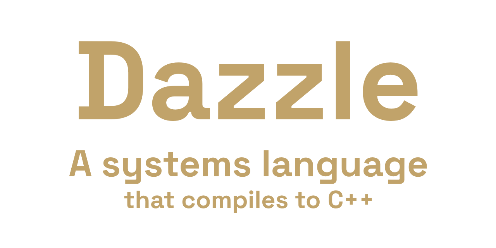
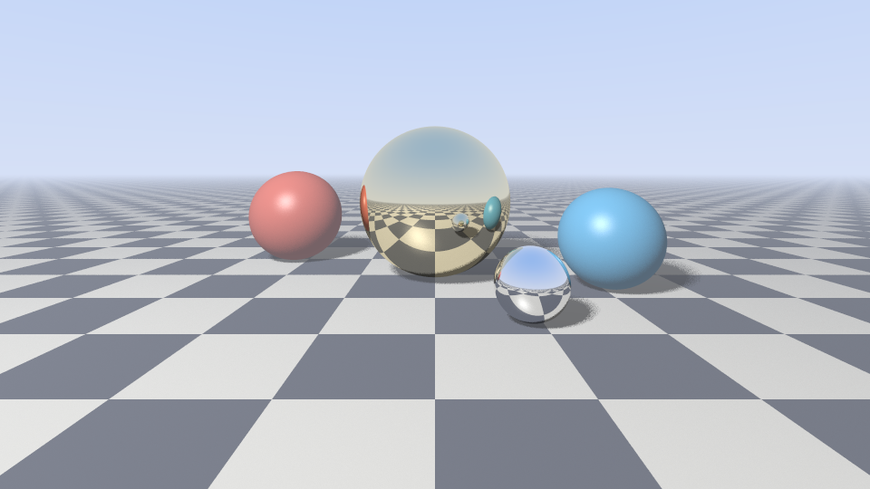

<p align="center">
  
</p>

<p align="center"><b>Safe systems programming with automatic memory placement</b></p>

<p align="center">
  <a href="https://dazzle-lang.github.io/playground/?example=order-reference">Try it in the browser</a> ·
  <a href="https://dazzle-lang.github.io/tour/overview/">Tour</a> ·
  <a href="#install">Install</a> ·
  <a href="docs/spec/README.md">Specification</a>
</p>

Dazzle checks when references can become invalid and chooses where allocations live. Ordinary
code passes no allocators. Scope regions release their memory together, with no garbage
collector. Dazzle compiles to standard C++17 and uses C and C++ libraries directly.

## Safe, without a borrow checker

```rust
struct Order {
    pub number: i32
    pub total_cents: i32
}

fn main() {
    let mut orders = List<Order>()
    orders.push(Order{ number: 17, total_cents: 2000 })

    let number = &orders[0].number
    orders[0].total_cents += 500
    println!("Order {}: {} cents", number, orders[0].total_cents)

    orders.push(Order{ number: 18, total_cents: 1200 })
}
```

`&orders[0].number` takes a reference to the first order's number. Updating the total
leaves that number in place. If you add the next order before printing, `push` can move
the list's backing array and invalidate the reference. The compiler points to both the
call and the later use. [See both versions](https://dazzle-lang.github.io/#safe-code-without-a-borrow-checker).

A helper can push a string into a list it receives as a parameter. Dazzle puts the
string's text in the same region as the list's backing array. Call the helper with a
different list and the new string uses that list's region.
[Follow both calls and their allocations](https://dazzle-lang.github.io/tour/memory-placement/).

## Install

On Linux or macOS:

```bash
curl -fsSL https://dazzle-lang.github.io/install.sh | sh
```

On Windows, in PowerShell:

```powershell
irm https://dazzle-lang.github.io/install.ps1 | iex
```

Then:

```bash
dz new hello && cd hello && dz run
```

All `dz` needs from the machine is a C++ compiler (clang++ or g++). To try it without
installing anything, the [playground](https://dazzle-lang.github.io/playground/) runs the
real compiler in your browser. [Installation](#installation) has the details and how to
build from source.

## C libraries, with no bindings

A few lines of manifest name a library's source, `dz` builds it, and libclang reads its
header. Its functions, structs, enums and constants are then an ordinary module:

```toml
[dependencies]
rl = { cpp = "raylib" }

[cpp.libs.raylib]
root         = "vendor/raylib/src"
sources      = ["*.c"]
include_dirs = [".", "external/glfw/include"]
defines      = ["PLATFORM_DESKTOP", "GRAPHICS_API_OPENGL_33"]
import       = ["raylib.h"]
```

```rust
fn main() {
    rl::InitWindow(800, 450, "Dazzle + raylib")
    defer rl::CloseWindow()
    rl::SetTargetFPS(60)

    while !rl::WindowShouldClose() {
        rl::BeginDrawing()
        rl::ClearBackground(rl::RAYWHITE)
        rl::DrawText("Hello from Dazzle", 190, 200, 40, rl::DARKGRAY)
        rl::DrawCircleV(rl::GetMousePosition(), 8, rl::MAROON)
        rl::EndDrawing()
    }
}
```

C++ libraries work the same way: classes, overloaded functions and methods, default
arguments, references and the template instances you name. Every example in
[`examples/`](examples) is built like this, on raylib, SDL3, Dear ImGui, Box2D, sokol, stb,
RGFW and miniaudio:

<p align="center">
  
  
</p>
<p align="center">
  
  
</p>

## An upgrade of C++, not a new toolchain

Dazzle's goal is close to [Carbon](https://github.com/carbon-language/carbon-lang)'s, with
a different route: instead of bringing its own LLVM-based toolchain, it compiles to standard
C++17. Whatever compiler, debugger, profiler or console SDK a C++ project already uses keeps
working, and Dazzle code links into that project without changing anything around it. It
keeps C++'s control and drops forty years of accumulated syntax: RAII reduced to three
special members, no allocator to pass around, encapsulation the compiler enforces, errors as
values instead of exceptions, and generics checked where they are written. The compiler is
written in Rust.

> **Status: 0.1, released November 2026.** Dazzle compiles, runs, checks ownership,
> places memory, calls C and C++, and has a language server;
> [`examples/breakout`](examples/breakout) is a complete game written in it. It is young:
> the standard library is still growing (see [Status](#status-and-roadmap)), and **the
> language still changes**: every change is a revision row in the
> [changelog](docs/spec/21-changelog.md).

---

## Why Dazzle

C++ gives you control and abstraction, but buries them under undefined behaviour and syntax
nobody can hold in their head. Dazzle keeps what C++ is for (RAII, encapsulation, layered
abstractions that hold up in a large codebase, zero-cost generics) and replaces the parts
that make it hard. Its principles, in priority order:

1. **You can always see the machine.** No hidden allocations, no hidden control flow, no
   garbage collector, no runtime you did not ask for.
2. **Destruction is deterministic and automatic.** RAII with three special members: a
   constructor, `copy` and `drop`.
3. **Encapsulation is enforced, not conventional.** Private is the default.
4. **Errors point at your code**, never at generated code or a 400-line template trace.
5. **The escape hatch is a door, not a hole.** C++ interop is a first-class feature: an
   existing C or C++ library is used as it is, from its own source and headers.
6. **Compile fast.**

**On one thread, a program with no `unsafe` has no undefined behaviour**, and Dazzle keeps
that promise without Rust's rules. Use after move, double free, and a reference used after a
call moved or freed what it points into are compile-time errors; every value is initialised,
every index is checked, and arithmetic is defined. Yet a `&mut` and a `&` may point at the
same value, and no struct carries a lifetime parameter. Raw pointers are read and written
only inside `unsafe`, so every unchecked access can be found. The promise ends at `unsafe`,
at the C and C++ a program calls, and at threads, which Dazzle does not have yet (spec
[§1.1](docs/spec/01-design-principles.md#11-non-goals),
[D-0094](docs/decisions/D-0094-safe-code-has-no-undefined-behaviour.md)).

### Where it fits

Anywhere you would otherwise reach for C++: code that needs predictable performance, no
garbage collector, and direct access to C and C++ libraries.

- **Games and engines.** This is the furthest along today:
  [`examples/breakout`](examples/breakout) is a game written with no C++ of its own, on top
  of raylib built from its own source.
- **Embedded and firmware.** There is no runtime and no garbage collector, destruction is
  deterministic, and the output is C++17 built with `-fno-exceptions -fno-rtti`, which any
  vendor toolchain can compile. Freestanding targets (no heap, no operating system, boards
  such as STM32 and AVR) are on the roadmap as M17; today Dazzle targets Windows, Linux and
  macOS.
- **Tools and native applications**: command-line tools, editors and desktop programs,
  where startup time and memory use matter.
- **Real-time and performance-critical code**: simulation, audio, and anything where a
  garbage-collector pause is a bug.
- **Inside an existing C++ codebase.** What Dazzle produces is standard C++ (`dz cpp`
  writes it out), so it can be adopted one module at a time rather than all at once. Building
  a module straight to a static or shared library is declared in the manifest but not built
  yet.

### Why compile to C++?

A new language usually means a new toolchain, and a new toolchain is what keeps it out of
existing projects. Compiling to C++17 means the C++ compiler a team already trusts does the
code generation, so Dazzle runs wherever C++ runs, including console and embedded SDKs whose
compilers no new backend supports. Debuggers and profilers show the `.dz` source, through
`#line` directives. And there is no foreign-function boundary to C++: a Dazzle module is C++
by the time it is compiled.

The generated C++ is **not meant to be read** any more than an object file is: it is full of
`#line` directives, temporaries and helpers, and it is written for the C++ compiler. What
matters is that it is standard and portable, and compiles warning-clean under both clang++
and g++ with `-fno-exceptions -fno-rtti`.

## The language at a glance

One small program shows most of it: a type whose memory the compiler places, a public name
for that memory (a **tie**), methods that say what they may end (**`kills`**) and where a
result points (**`in`**), a function that can fail (**`!->`**), and the error a stale
reference gets:

```rust
struct Enemy {
    pub hp: i32 = 10
}

struct Level {
    pub name:  String
    m_enemies: List<Enemy>                   // no allocator: the compiler places the memory
    tie @enemies = m_enemies@items           // a public name for that private memory

    Level(name: &str) {
        self.name = String(name)
    }

    pub fn spawn(&mut self, e: Enemy) kills self@enemies {   // says what it may move
        m_enemies.push(e)
    }

    pub fn first(&self) -> ^Enemy in self@enemies {          // says where it points
        return m_enemies.first()
    }
}

fn load(path: &str) !-> Level {              // `!->`: this can fail
    if path.len == 0 {
        return error(1, "no path given")
    }
    return Level(path)
}

fn main() {
    let mut level = load("level1.dat") or panic!("cannot load")   // handled where it is called
    level.spawn(Enemy{})
    let boss = level.first() or return       // a reference into the level's array
    println!("{} {}", level.name, boss.hp)
    level.spawn(Enemy{ hp: 50 })             // may move that array, which ends `boss`:
    // println!("{}", boss.hp)               //   reading it now is error[DZ0413]
}                                            // `level` is freed here, exactly once
```

### Errors are values, not exceptions

There are no exceptions, no `try`/`catch` and no `Result<T, E>`. A function that can fail
says so on its signature with `!->`, and the caller handles the failure with **one postfix
`or` clause**. The same clause handles an optional value (`T?`) and a nullable pointer
(`^T`):

```rust
enum ErrorCode : u32 {
    Empty = 1
    TooLong
}

fn parse_name(text: &str) !-> &str {        // the name is a view of `text`
    if text.len == 0 {
        return error(ErrorCode::Empty as u32, "a name cannot be empty")
    }
    if text.len > 16 {
        return error(ErrorCode::TooLong as u32, "name too long: {} bytes", text.len)
    }
    return text
}

fn greet(text: &str) !-> i32 {
    let name = parse_name(text) or return          // propagate
    println!("hello, {}", name)
    return 0
}

fn main() {
    let name = parse_name("") or "stranger"        // fall back
    println!("hello, {}", name)
    greet("Ada") or ignore                         // deliberately drop the failure
    greet("a name that is far too long") or { e -> // handle it
        println!("failed at {}:{}: {}", e.location.file, e.location.line, e.message)
        0
    }
}
```

```text
hello, stranger
hello, Ada
failed at src/main.dz:11: name too long: 27 bytes
```

An `Error` is 32 bytes and **never allocates**. It carries a code, a message and the source
location where it was created, which is most of what a stack trace gives you, at no runtime
cost. A failure cannot be stored in a variable, only handled, so forgetting to handle one
is a compile error:

```text
error[DZ0510]: fallible call not consumed
  ┌─ src/main.dz:9:17
  │
9 │     let level = load("level1.dat")
  │                 ^^^^^^^^^^^^^^^^^^ a failure cannot be stored, only handled
  │
  = help: add an `or` clause: `let v = f() or return`, or `let v = f() or <fallback>` (spec §9.7)
```

### Ownership: `own`, three special members, and no rule of five

A struct has at most three special members, and that is the whole list: a **constructor**
(named after the struct), a **`drop`** (the destructor) and a **`copy`** (the copy
constructor). There is no move constructor, no move assignment, no copy assignment and no
default constructor to write; the compiler derives them. A field marked **`own`** is a
pointer the struct is responsible for releasing, such as a handle a C library gave it:

```rust
struct Image {
    pub width:  i32
    pub height: i32
    m_surface:  own ^mut sdl::SDL_Surface   // Image frees this; private, like every unmarked field

    Image(width: i32, height: i32) {         // the constructor
        self.width = width
        self.height = height
        m_surface = sdl::SDL_CreateSurface(width, height, .SDL_PIXELFORMAT_RGBA8888)
    }
}

impl Drop for Image {                        // runs exactly once, at the end of the owner's scope
    fn drop(&mut self) {
        sdl::SDL_DestroySurface(m_surface)
    }
}

impl Copy for Image {                        // opt-in: without it, Image is move-only
    fn copy(&mut self, other: &Self) {
        width = other.width
        height = other.height
        m_surface = sdl::SDL_DuplicateSurface(other.m_surface)
    }
}

fn main() {
    let a = Image(64, 64)
    let b = a                                // a copy: runs `copy`
    let c = move(a)                          // a move: `a` is reset to its defaults
    println!("{} {}", b.width, c.width)
}                                            // c, b and a are dropped, in that order
```

`own` is for what Dazzle does not manage itself: here a surface SDL3 allocated, elsewhere a
file, a window or a GPU buffer from a C library, used as it is from its own source
([below](#use-c-and-c-libraries-as-they-are)). Dazzle code never names an allocator, and its
own data needs none of the three members: a struct of `List` and `String` fields is freed,
copied and moved with no code at all.

The rules that hold this together:

- **`own` makes the struct move-only.** A struct with an `own` field, or a `drop`, can only
  be moved (`move(x)`) unless it implements `Copy`. A plain struct of copyable fields is
  copyable with no code at all.
- **An `own` field with no `drop` is a compile error**, so a resource cannot be acquired and
  forgotten:

  ```text
  error[DZ0412]: `Image` owns a resource but never releases it
    ┌─ src/main.dz:4:5
    │
  4 │     m_surface:  own ^mut sdl::SDL_Surface   // Image frees this; private, like every unmarked field
    │     ^^^^^^^^^ this field is marked `own`
    │
    = help: add a `drop()` that releases `m_surface`, or remove `own` if Image does not own this pointer (spec §6.5)
  ```

- **A moved-from value is reset to its defaults**, not left in C++'s "valid but
  unspecified" state. Its `drop` still runs, and releases nothing, because `m_surface` is
  now null. Reading it again is an error:

  ```text
  error[DZ0401]: `a` was moved and cannot be used again
     ┌─ src/main.dz:31:26
     │
  30 │     let c = move(a)                          // a move: `a` is reset to its defaults
     │             ------- moved here
  31 │     println!("{} {} {}", a.width, b.width, c.width)
     │                          ^^^^^^^ used here after the move
     │
     = help: a moved-from value is left at its defaults, and reading it back would almost never be what was meant (spec §6.4)
  ```

- **Every value is initialised.** `let img: Image` is an empty image, never garbage memory,
  and `copy` always runs on a defaults-initialised value, so returning early from it
  leaves something valid.

**What it becomes in C++.** The three members map onto C++ special members, and the rest of
the rule of five is synthesised, so C++ itself enforces destruction order, temporaries and
the deleted copy of a move-only type. Abridged from `dz cpp`'s output for `Image`:

```cpp
struct Image {
    int32_t width{};
    int32_t height{};
    ::SDL_Surface* m_surface{};

    Image(int32_t width, int32_t height);     // the constructor
    Image() = default;                        // every field at its default
    ~Image();                                 // drop
    Image(const Image& other);                // copy
    Image& operator=(const Image& other);     // synthesised: drop, reset, copy
    Image(Image&& other);                     // synthesised: steal, reset the source
    Image& operator=(Image&& other);          // synthesised: drop, steal, reset the source
};

Image::Image(Image&& other) {
    width = other.width;
    height = other.height;
    m_surface = other.m_surface;
    other.reset_to_defaults__();              // the moved-from Image is empty, not unspecified
}

Image& Image::operator=(const Image& other) {
    if (this == &other) { return *this; }
    this->~Image();
    new (static_cast<void*>(this)) Image();
    new (static_cast<void*>(this)) Image(other);
    return *this;
}
```

| Dazzle | C++ |
|---|---|
| `Image(w, h)` | `Image(int32_t w, int32_t h)` |
| `impl Drop`'s `drop` | `~Image()` |
| `impl Copy`'s `copy` | `Image(const Image&)`, run on a defaults-initialised `*this` |
| move | `Image(Image&&)`: memberwise steal, then reset the source to its defaults |
| copy and move assignment | destroy, reset, then copy or steal, with a self-assignment guard |
| a move-only type | its copy constructor and copy assignment `= delete`d |

The last row is a second line of defence: even if Dazzle's own move checking had a hole,
the C++ compiler would refuse the copy. [`examples/ownership`](examples/ownership) builds a
growable array this way, and [spec §6](docs/spec/06-value-semantics-ownership-copy.md) has
the full rules.

`&T` and `&mut T` are references, checked as the next section describes. `^T` is a C
pointer, and reading or writing through one happens inside `unsafe`. The standard library
has `Rc`, `Weak` and `Box` for everything in between.

### References checked by ties, memory placed by the compiler

A reference lives only where references live: a local, a parameter, a result, or a *view
struct* such as an iterator. It never sits in an ordinary field or a container, so no
struct needs a lifetime parameter. What is checked is the bug C++ code actually has: a
reference used after a call grew, shrank or freed the memory it points into.

A type names its memory with **ties**, and every function says in its signature which ties
it may end, with a **`kills`** clause. A call ends every reference into what it kills:

```rust
// in std's List: each signature says what a call may end
pub fn push(&mut self, v: T) kills self@items sends v to self
pub fn len(&self) -> usize                         // no clause: kills nothing

// in your code
let n = counts.get_or_insert(word, 0)              // a reference into the table
counts.insert(other, 1)                            // may grow the table
n += 1        // error[DZ0413]: `insert` kills `counts@items`, and `n` points into it
```

The compiler checks each clause against its function's body, both ways, and `dz fix`
writes the clause a body needs. Aliasing stays legal: `&mut xs[i]` beside `&xs[j]`, or a
`&mut` and a `&` to one value, is fine, as long as nothing in between can move the memory.

**Ordinary code names no allocator.** `List<Enemy>()` and `String(name)` get their
memory in a scope region, in the caller’s result storage, or on the heap. A helper
can build into the home of a container it was lent. A `sends` clause tells callers where
ownership can travel, so the compiler can pick a home that lasts long enough. The editor
shows where allocations go, and `dz placements` lists them with their reasons.
`DZ_REGIONS=0` builds the same program with allocator-backed memory on the heap for comparison.
[Spec §6.7](docs/spec/06-value-semantics-ownership-copy.md) and
[§14.6](docs/spec/14-memory-and-allocators.md) have the rules.

### Modules and imports: declared once, in the manifest

Dazzle has no import line at the top of each file. **A module is a project**: a folder with
a `dazzle.toml` that lists its source files, and **what the module can name is declared
once, in that manifest**, for every one of its files.

```
game/
  dazzle.toml               module "game"
  src/
    main.dz
    gameplay/player.dz      just a folder: it means nothing to the compiler
  libs/
    engine/dazzle.toml      module "engine"
    physics/dazzle.toml     module "physics"
```

```toml
[module]
name    = "game"
sources = ["src/**/*.dz"]

[dependencies]
std    = { open = true }                        # String, List, Vec2: written bare
engine = { path = "libs/engine", open = true }  # Transform, and also engine::Transform
phys   = { path = "libs/physics" }              # always qualified: phys::Body
rl     = { cpp = "raylib" }                     # a C library: rl::DrawText
```

- **Folders are organisation only.** Every file in `src/**` sees every other file's
  declarations without importing anything, and declaration order never matters. Moving
  `player.dz` to another folder changes nothing anywhere.
- **The key is the name, and you choose it.** `rl = { cpp = "raylib" }` means every file
  writes `rl::`. No file can call the library `rl` while the next calls it `raylib`, and
  swapping one library for another is a one-line change.
- **`open = true` puts a dependency's exports at the root**, so they are written bare. A
  game opens what it uses on every line, like the standard library or its engine, and keeps
  a C API or a platform backend behind a name. `std` is a dependency like any other: it
  must be listed, and a module that does not open it writes `std::String`.
- **No silent precedence.** If two opened dependencies both export `Vec2`, a bare `Vec2` is
  an error (`DZ0310`) on the line that writes it, not a guess. Write `std::Vec2`, or choose
  once for the whole module:

  ```toml
  [names]
  Vec2 = "std"
  ```

- **Dependencies are private.** A library's own dependencies are invisible to the modules
  that use it, unless it marks one `pub = true`. Users then reach it one level down
  (`engine::math::Vec3`) and can rename or open it with `via`:
  `math = { via = "engine::math", open = true }`. A private dependency cannot leak through
  a `pub` signature (`DZ0311`), and a dependency nothing uses is a warning (`DZ0313`).
- **`import` exists, as the exception.** When one file wants something the manifest does not
  give it, it can bring in names or shorten a path, for that file only. It can never reach a
  module the manifest does not list:

  ```rust
  import phys::{ Vec3, Body }     // a bare Vec3 is phys's in this file
  import engine::render as gfx    // gfx::draw(...) in this file
  ```

- **`::` is resolved at compile time, `.` at run time.** `rl::shapes::Rectangle`,
  `Color::Red` and `List<f32>::with_capacity(8)` all use `::`; `.` is always a field or a
  method on a value, and reaches through pointers on its own (there is no `->`).

This is closer to C# projects or CMake targets than to Go or Rust, where the
directory tree is the module tree. [Spec §3](docs/spec/03-projects-modules-and-imports.md)
has the rest, including build flags and how a library is built.

### Use C and C++ libraries as they are

A library compiled from **source** is built by `dz` from a few lines of manifest, and its
header is read by libclang. Its functions, structs, enums, macros and constants then become
an ordinary Dazzle module:

```toml
[dependencies]
rl = { cpp = "raylib" }

[cpp.libs.raylib]
root         = "vendor/raylib/src"
sources      = ["*.c"]
include_dirs = [".", "external/glfw/include"]
defines      = ["PLATFORM_DESKTOP", "GRAPHICS_API_OPENGL_33"]
import       = ["raylib.h"]

[cpp.libs.raylib.target.windows]
link_libs = ["opengl32", "gdi32", "winmm", "user32", "shell32"]
```

That covers C++ too: namespaces, classes, constructors, `const` and mutating methods,
overloaded functions and methods chosen by argument type, default arguments left out,
array parameters, references, classes that C++ destroys itself, and named template
instances. [`examples/sdl3`](examples/sdl3) calls Dear ImGui's own C++ API this way, with no
C binding in between. From [`tests/run/cppinterop`](tests/run/cppinterop), which builds a
small C++ library from source:

```rust
let mut counter = shp::shapes::Counter(10)    // a C++ class and its constructor
counter.add(5)                                // an overload set, resolved by argument type
counter.add(a)                                //   …the other `add`
shp::shapes::scaled(5)                        // `scaled(int, int times = 2, int plus = 0)`
shp::shapes::translate(&mut moving, 1, 1)     // `Point&` is a `&mut Point`
let pair = shp::IntPair(3, 9)                 // `[cpp.instantiate] "shapes::Pair<int>"`
```

A library with a CMake build of its own, such as SDL3, is built by its CMake instead:
the recipe names the folder with `cmake = "vendor/SDL"`. A function that takes only values
is safe to call; one that can be handed a pointer is safe once the recipe vouches for the
library with `keeps`, which lists the functions that keep a pointer past the call and stay
`unsafe` (spec §15.1, §15.2).

The generated code is plain C++17 with `#line` directives pointing back at your `.dz`
files, so gdb, the Visual Studio debugger and profilers all show your source.

### Macros you can still get completion inside

Macros are declarative: a pattern that reads like a function's parameters, and an
expansion written in Dazzle. They expand on syntax before name resolution, are hygienic for
locals, and the editor keeps completing and hovering *inside* an invocation. A state
machine, for example, is a user macro rather than a language feature (trimmed from
[`tests/run/machine`](tests/run/machine)):

```rust
#machine ButtonState(ctx: &ButtonCtx, input: &Input, btn: &mut Button) {
    state DefaultState {
        if input.mouse_down && input.over {
            return .TransitionState{}
        }
    }

    state TransitionState(t: f32 = 0) {
        t += ctx.delta_time
        btn.scale = lerp(1, 2, t)
        if t >= 1 {
            return .DefaultState{}
        }
    }
}
```

`#machine` is about sixty lines of Dazzle in the game's own code. It writes a struct per
state, a tagged union over them and a `step` method. `dz expand` prints exactly what any
invocation turns into. Formatting is built from the same machinery: `println!`, `format!`
and `panic!` check their format string against their arguments at compile time.

### And the rest

- **Generics checked at the definition**, then monomorphized by Dazzle rather than by C++
  templates. A mistake in a generic function is reported in that function, once.
- **Tagged unions and exhaustive `switch`**, with no fallthrough. A missing case is a
  compile error, and the editor can write the missing arms for you.
- **Traits** with static dispatch through bounds (`<T: Ord>`) or dynamic dispatch through a
  fat pointer (`^Trait`); single **struct inheritance** with `virtual`/`override` where you
  want a class hierarchy.
- **Reflection** through one static type table: `typeinfo_of<T>()`, with field tags, at zero
  bytes per struct.
- **Tests and benchmarks are part of the language**: `#[test]` and `#[bench]` sit beside the
  code they cover, and each test runs in its own process, so one crash does not hide the
  rest.

  ```rust
  #[test]
  fn clamp_keeps_values_in_range() {
      assert(clamp01(2) == 1)
      assert(clamp01(-3) == 0, "negative values clamp to zero")
  }
  ```

## Error messages, tooling, and working with an LLM

Dazzle is designed to be learned from the compiler. Programmers and coding agents can use
the same diagnostics to understand a rule, apply an edit, and check the result.

- **Every diagnostic has a stable code** (`DZ0510`), points at your code and never at the
  generated C++, and nearly always ends in a `help:` that says what to write instead and
  which spec section explains why.
- **`dz explain DZ0510`** prints a diagnostic's rule, why it exists, and a wrong and a
  corrected program.
- **One mistake, one error.** The parser suppresses cascades, so a typo does not produce
  four restatements of itself.
- **Errors you can apply.** A diagnostic can carry the exact edit that fixes it: a quick fix
  in the editor (fill a `switch`'s missing arms, implement a trait method an `impl` left
  out), and **`dz fix`** applies every one the compiler is certain of. **`dz check
  --format=json`** gives every diagnostic, with its fixes, as JSON.
- **A language server** (`dz lsp`) with diagnostics as you type, hover, go-to-definition,
  references, rename, completion (including inside macro invocations), signature help,
  inlay hints and the outline. It keeps answering around syntax errors. There is also a
  **VS Code extension** with highlighting, run and debug buttons, and debugger
  visualisers.
- **`dz expand`** shows what a macro wrote, and `dz fmt` is the single canonical format.
- **One way to do things:** one `or` clause instead of `?`/`try`/`catch`, no function
  overloading for now (one name is one symbol), and no implicit numeric conversions.

**Planned**, tracked in the backlog ([`docs/tasks.md`](docs/tasks.md)):

- Diagnostics that recognise **habits from Rust and C++** (`Result<T, E>`, `x?`, `nullptr`,
  `p->x`, `Foo::new()`) and give the Dazzle spelling.
- `dz api <module>`, which prints a module's public surface, an imported C++ library's
  included, as Dazzle signatures.
- Editor queries from the command line, a primer that `dz new` adds to a project, machine-readable test
  output, and `dz run --frames N` so a game can be checked without anyone watching its
  window.

## Installation

One line installs the latest [release](https://github.com/dazzle-lang/Dazzle/releases):
`dz`, and on Linux and Windows the libclang it reads C and C++ headers with.

```bash
curl -fsSL https://dazzle-lang.github.io/install.sh | sh
```

```powershell
irm https://dazzle-lang.github.io/install.ps1 | iex
```

The first is for Linux and macOS, the second for Windows PowerShell. Each checks the download
against its checksum, unpacks it into `~/.dazzle` and puts `~/.dazzle/bin` on your `PATH`;
run it again to update. There are releases for Linux on x86-64 and ARM64 (glibc 2.34 or newer),
macOS on Apple silicon, and Windows on x86-64.

`dz` needs a **C++17 compiler**, clang++ or g++: on macOS, `xcode-select --install`; on
Windows, LLVM's clang++ with the Visual Studio Build Tools, or MinGW's g++. A library built
by its own CMake project, such as SDL3 in `examples/sdl3`, needs **CMake** too. **The VS Code
extension** is `dazzle.vsix` in each release: `code --install-extension dazzle.vsix`.

**From source**, you need a current stable **Rust** toolchain, a C++ compiler, and
**libclang** from any recent LLVM (LLVM's installer on Windows, `libclang-dev` on Ubuntu,
Xcode's command-line tools or Homebrew's `llvm` on macOS):

```bash
git clone --recursive https://github.com/dazzle-lang/Dazzle.git
```

```bash
cd Dazzle && cargo build --release
```

`--recursive` fetches the C and C++ libraries the examples build from source (raylib, SDL3,
Dear ImGui, RGFW, sokol, stb, miniaudio and Box2D), which are git submodules in `examples/vendor/`. In a
checkout made without it, run `git submodule update --init`. Nothing outside `examples/`
needs them. The compiler is then `target/release/dz` (`dz.exe` on Windows); put it on your
`PATH`. `dz` finds libclang beside its own executable, in a `lib/` folder next to it, through
`LIBCLANG_PATH`, or in an installed LLVM. To build the VS Code extension from the checkout
(needs Node.js):

```bash
cd editors/vscode && npm install && npm run deploy
```

## Usage

```bash
dz new hello
```

makes a project: a folder with a `dazzle.toml`,

```toml
[module]
name    = "hello"
sources = ["src/**/*.dz"]

[dependencies]
std = { open = true }

[build]
output = "executable"
```

and `src/main.dz`, with a function, a call of it, and a test beside it:

```rust
fn main() {
    println!("{}", greeting("world"))
}

fn greeting(name: &str) -> String {
    return format!("Hello, {}!", name)
}

// `dz test` runs every `#[test]`; `dz run` and `dz build` leave them out.
#[test]
fn greets_by_name() {
    if greeting("Dazzle").as_str() != "Hello, Dazzle!" {
        panic!("the greeting should name who it greets")
    }
}
```

`cd hello`, then `dz run` prints `Hello, world!` and `dz test` runs the test.

| Command | Does |
|---|---|
| `dz new <dir>` | create a project there: a manifest, a hello world and a test |
| `dz run [dir]` | build and run |
| `dz build [dir]` | build an executable into `build/bin/` |
| `dz check [dir]` | analyse only: every diagnostic, no C++ compiler needed (`--format=json` for JSON) |
| `dz fix [dir]` | apply the fixes the compiler is certain of (`--dry-run` to list them) |
| `dz explain <code>` | what a diagnostic means, with a wrong and a right program |
| `dz test [dir] [filter]` | run the `#[test]` functions, each in its own process |
| `dz bench [dir]` | time the `#[bench]` functions (release mode by default) |
| `dz fmt <file>` | format in place (`--stdout` to print instead, `--check` to only report) |
| `dz expand <file>` | the file with every macro invocation expanded |
| `dz cpp [dir]` | write the generated C++ to `build/cpp/` |
| `dz placements [dir]` | where each allocation goes, a scope's region or the heap, and why (`--format=json` for JSON) |
| `dz lsp` | the language server, on stdio |

`dir` defaults to the current directory. `run`, `build`, `cpp`, `test` and `bench` take
`--debug` (the default, `-O0`), `--release` (`-O2`) or `--shipping` (`-O3`); the two
optimised modes also link with link-time optimisation, so calls between modules can be
inlined. `--track-memory` records every allocation and reports leaks and bad frees when the
program exits.

**Examples** in [`examples/`](examples) to start from, each a complete project on a
different C library, built from source and called with no bindings:

| | | |
|---|---|---|
| [`breakout`](examples/breakout) | raylib | a complete game: the rules are plain Dazzle in [`game`](examples/breakout/game), drawn with raylib |
| [`sdl3`](examples/sdl3) | SDL3 + Dear ImGui | a real-time 3D scene: per-pixel lighting, shadows, fog and instanced grass in GLSL, on SDL3 built by its own CMake, with a Dear ImGui panel that changes it live |
| [`box2d`](examples/box2d) | Box2D + sokol | rigid-body physics: two C libraries in one project |
| [`sokol`](examples/sokol) | sokol | a particle fountain on sokol_app, sokol_gfx and sokol_gl, with C callbacks into Dazzle |
| [`stb`](examples/stb) | stb_image_write | a ray tracer that saves its render as a PNG |
| [`rgfw`](examples/rgfw) | RGFW | a plasma computed pixel by pixel and blitted to a window |
| [`raylib`](examples/raylib) | raylib | the smallest windowed program |
| [`miniaudio`](examples/miniaudio) | miniaudio | a synthesizer, with Dazzle as the real-time audio callback |
| [`ownership`](examples/ownership) | none | a growable array from scratch: `own`, the three special members, copies and moves |

## Compatibility

- **Platforms:** Windows, Linux and macOS. CI builds and tests on all three for every change.
- **C++ compilers:** clang++ and g++. The generated code is C++17, compiled with
  `-fno-exceptions -fno-rtti` and expected to be warning-clean under `-Wall -Wextra` on both;
  clang++ 19 and 21 and g++ 13 and 14 are verified. On Windows that means clang++ or MinGW g++. MSVC's
  `cl.exe` is not supported, since `dz` passes GCC-style flags. `dz` uses the first of
  `clang++`, `g++` and `c++` it finds; choose another with `--cxx`, the `DZ_CXX` environment
  variable, or `[build] cxx` in the manifest.
- **C and C++ libraries:** C, and C++ through namespaces, classes, methods, overloaded
  functions and methods, default arguments, references and named template instances.
  Variadic C functions and inheritance between imported C++ classes are not imported yet;
  they are open tasks.
- **The output is plain C++**, so anything that links with C++ links with Dazzle.

## Status and roadmap

**0.1 was released on 4 November 2026.** You can write a real program in it today: the
[examples](examples) include a complete game on raylib, a real-time 3D scene on SDL3 with a
Dear ImGui panel, rigid-body physics on Box2D and a synthesizer on miniaudio. A program
with no `unsafe` has no undefined behaviour on one thread, whole programs run about as fast
as their C++, and VS Code has a language server, a debugger and run buttons. Releases are
built for Linux, macOS and Windows.

It is young. The language still changes, and every change is a row in the
[changelog](docs/spec/21-changelog.md). The standard library is still growing.

### Next: 0.2

**Landed since 0.1:** automatic memory placement across calls with `sends`, incremental
builds, and a [Dear ImGui panel in the SDL3 example](examples/sdl3). Both small-program
build targets have been met on Linux.

**Remaining:** code generation and tooling fixes, standard-library additions, broader C++
imports, new benchmarks, and release notes. [The road to 0.2](https://dazzle-lang.github.io/project/roadmap/)
has the current work and measurements.

### Later

- **Packages:** dependencies fetched from git, Dazzle packages and C libraries alike,
  pinned by a lockfile, if they miss 0.2.
- **Scale:** a game of ten thousand lines, to see how the safety rules hold in a large
  program, and fewer of the cases where the compiler still puts memory on the heap.
- **Hot reload:** a rebuilt module swapped into a running game, keeping its state.
- **The editor:** incremental analysis, and the rest of the quick fixes.
- **Microcontrollers:** builds with no heap and no operating system, for boards such as an
  Arduino Uno and an STM32.
- **The web:** the same game running in a browser, through Emscripten.
- **Threads:** a mutex, atomics and a job system.

The website's [road to 0.2](https://dazzle-lang.github.io/project/roadmap/) links each item
to its task. The milestones are in [spec §19](docs/spec/19-roadmap.md), and every open task
is in the backlog, [`docs/tasks.md`](docs/tasks.md).

**How fast it is today:** whole programs take 0.77 to 1.17 times as long in Dazzle as in
C++; [Benchmarks](#benchmarks) has the numbers.

## Benchmarks

Three whole programs, each written idiomatically in both languages, built by the same
compiler with the same flags (`-O2` and link-time optimisation), checked to print the same
checksum over their whole result, and timed end to end as a user would run them:

| Program | What it does | clang++ | g++ | Peak memory |
|---|---|---:|---:|---:|
| A\* search | 200 searches across a 400×400 grid: a generic binary heap, hash maps keyed by a struct, allocation in every search | **0.77×** (319 / 413 ms) | **0.88×** (350 / 397 ms) | **0.75×** (9.5 / 12.6 MiB) |
| Tokenizer, parser and evaluator | 100,000 generated statements: a tree of tagged unions per statement, one in eight failing through `!->` | 1.17× (157 / 134 ms) | 1.07× (157 / 147 ms) | **0.94×** (141 / 151 MiB) |
| Word count | 2,000,000 generated words counted in a hash map, then sorted | **0.91×** (141 / 155 ms) | 1.02× (171 / 166 ms) | 1.17× (37.6 / 32.2 MiB) |

Each figure is Dazzle's over C++'s, below 1.00× where Dazzle is ahead, from the median of
ten alternating runs (AMD Ryzen 7 H 255, clang 19, g++ 14, Dazzle at `f0a0ab9`).

Each half uses its own standard library the obvious way, as benchmarks between languages
usually do: the C++ uses `std::vector`, `std::unordered_map`, `std::priority_queue`,
`std::string`, `std::unique_ptr` and `std::sort`. So a ratio includes each library's
design, and the largest difference is the hash table: Dazzle's `HashMap` is a SwissTable,
one array of slots probed eight at a time, where `std::unordered_map` allocates a node per
entry. That is most of A\* search's lead. Measured once with Dazzle's map, heap and sort
ported line for line into the C++ halves, A\* search was even with C++ (1.00× and 1.01×),
the parser and evaluator 1.13–1.19× and the word count 1.13–1.29×. Some of Dazzle's cost
is its own, by design: every index is checked and integer arithmetic wraps in every build.

**Building** takes longer than the C++ half's single file: 1.6–2.1 s against 0.4–0.6 s.
Dazzle's own phases, from reading the manifests to emitting the C++, take about 100 ms;
importing `stdlib.h` with libclang about 85 ms; nearly all the rest is the C++ compiler on
the generated code, most of it the standard library's C++, compiled again in every build
(T-0102).

[`tests/bench_programs`](tests/bench_programs) has the programs, the rules and
[`RESULTS.md`](tests/bench_programs/RESULTS.md), the latest run in full, and
`python tools/bench_programs.py` measures them on your machine. The
[benchmarks page](https://dazzle-lang.github.io/project/benchmarks/) keeps every run, so the
ratios can be seen to change as the compiler and the standard library do.

## Documentation

| | |
|---|---|
| [`docs/spec/`](docs/spec/README.md) | the language specification, the contract. **§0.1 is the whole language on one page.** |
| [`docs/decisions/`](docs/decisions/README.md) | every design decision, and the questions still open |
| [`docs/tasks.md`](docs/tasks.md) | the backlog: open work by milestone |
| [`docs/log/`](docs/log/README.md) | what each milestone built and why |
| [`docs/testing.md`](docs/testing.md) | what each test corpus covers |
| [`CONTRIBUTING.md`](CONTRIBUTING.md) | how to report a problem, propose a change, and build and test the compiler |
| [`CLAUDE.md`](CLAUDE.md) | the invariants, conventions and commands, written for an AI assistant working in this repository and just as useful to a person |

## How Dazzle is made

Dazzle is built with AI. The language's design is its author's: its syntax and semantics,
and every decision recorded in [`docs/decisions/`](docs/decisions/README.md). The compiler,
its tests and much of the documentation are written by Claude, Anthropic's AI model, working
from that design and the [specification](docs/spec/README.md).

## License

[MIT](LICENSE). The libraries under `examples/vendor/` are submodules under licenses of their
own: raylib's and sokol's are zlib/libpng, SDL3's is zlib, RGFW's is libpng, Box2D's and Dear ImGui's are MIT, and stb and
miniaudio are public domain or MIT, at your choice.
