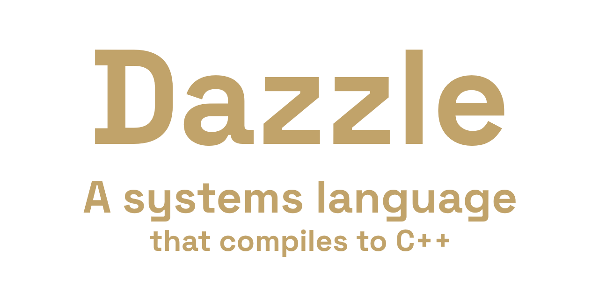

<p align="center">
  
</p>

**A systems language that compiles to readable C++17, meant for the places C++ is used
today.**

Dazzle has the control of C++ without forty years of accumulated syntax: RAII reduced to three
special members, encapsulation the compiler enforces, errors as values instead of
exceptions, generics checked where they are written, and C and C++ libraries used directly
from their source, with no wrapper or build system. The compiler is written in Rust.

```dz
fn main() {
    rl::InitWindow(800, 450, "Dazzle")
    defer rl::CloseWindow()

    while !rl::WindowShouldClose() {
        rl::BeginDrawing()
        rl::ClearBackground(rl::RAYWHITE)
        rl::DrawCircleV(rl::GetMousePosition(), 8, rl::MAROON)
        rl::EndDrawing()
    }
}
```

That is raylib, called with no bindings. `dz` compiled it from raylib's own seven `.c`
files, which is all a `dazzle.toml` recipe names. No CMake and no prebuilt library were
involved.

> **Status: pre-release.** The language is **0.1, unreleased**. It compiles, runs, checks
> ownership, calls C and C++, and has a language server; it already carries a small raylib
> game. It is not finished: 0.1 is declared once the editor support, the standard library
> and C++ interop are all complete (see [Status](#status-and-roadmap)). **Expect the
> language to change**: every change is a revision row in the
> [changelog](docs/spec/21-changelog.md).

---

## Why Dazzle

C++ gives you control and abstraction, but buries them under undefined behaviour and syntax
nobody can hold in their head. Odin gives you clarity, but takes away encapsulation, RAII
and layered abstractions that hold up in a large codebase. Dazzle aims at the space between
the two. Its principles, in priority order:

1. **You can always see the machine.** No hidden allocations, no hidden control flow, no
   garbage collector, no runtime you did not ask for.
2. **Destruction is deterministic and automatic.** RAII with three special members: a
   constructor, `copy` and `drop`.
3. **Encapsulation is enforced, not conventional.** Private is the default.
4. **Errors point at your code**, never at generated code or a 400-line template trace.
5. **The escape hatch is a door, not a hole.** C++ interop is a first-class feature:
   raylib, Jolt and Dear ImGui should work on day one.
6. **Compile fast.**

Dazzle is **not** trying to be memory-safe in Rust's sense. It prevents use-after-move and
double-free, and it marks every raw-pointer access with `unsafe` so you can find it, but it
has no lifetimes and no borrow checker.

### Where it fits

Anywhere you would otherwise reach for C++: code that needs predictable performance, no
garbage collector, and direct access to C and C++ libraries.

- **Games and engines.** This is the furthest along today: raylib builds from source with
  no bindings, and [`examples/breakout`](examples/breakout) is a game written with no C++ of
  its own.
- **Embedded and firmware.** There is no runtime and no garbage collector, destruction is
  deterministic, and the output is C++17 built with `-fno-exceptions -fno-rtti`, which any
  vendor toolchain can compile. Freestanding targets (no heap, no operating system, boards
  such as STM32 and AVR) are on the roadmap as M17; today Dazzle targets Windows, Linux and
  macOS.
- **Tools and native applications**: command-line tools, editors and desktop programs,
  where startup time and memory use matter.
- **Real-time and performance-critical code**: simulation, audio, and anything where a
  garbage-collector pause is a bug.
- **Inside an existing C++ codebase.** What Dazzle produces is plain C++ (`dz cpp` writes
  it out), so it can be adopted one module at a time rather than all at once. Building a
  module straight to a static or shared library is declared in the manifest but not built
  yet.

## The language at a glance

### Errors are values, not exceptions

There are no exceptions, no `try`/`catch` and no `Result<T, E>`. A function that can fail
says so on its signature with `!->`, and the caller handles the failure with **one postfix
`or` clause**. The same clause handles an optional value (`T?`) and a nullable pointer
(`^T`):

```dz
enum ErrorCode : u32 {
    Empty = 1
    TooLong
}

fn parse_name(text: str) !-> str {
    if text.len == 0 {
        return error(ErrorCode::Empty as u32, "a name cannot be empty")
    }
    if text.len > 16 {
        return error(ErrorCode::TooLong as u32, "name too long: {} bytes", text.len)
    }
    return text
}

fn greet(text: str) !-> i32 {
    let name = parse_name(text) or return          // propagate
    println!("hello, {}", name)
    return 0
}

fn main() {
    let name = parse_name("") or "stranger"        // fall back
    println!("hello, {}", name)
    greet("Ada") or ignore                         // deliberately drop the failure
    greet("a name that is far too long") or { e -> // handle it
        println!("failed at {}:{}: {}", e.location.file, e.location.line, e.message)
        0
    }
}
```

```text
hello, stranger
hello, Ada
failed at src/main.dz:11: name too long: 27 bytes
```

An `Error` is 32 bytes and **never allocates**. It carries a code, a message and the source
location where it was created, which is most of what a stack trace gives you, at no runtime
cost. A failure cannot be stored in a variable, only handled, so forgetting to handle one
is a compile error:

```text
error[DZ0510]: fallible call not consumed
  ┌─ src/main.dz:9:17
  │
9 │     let level = load("level1.dat")
  │                 ^^^^^^^^^^^^^^^^^^ a failure cannot be stored, only handled
  │
  = help: add an `or` clause: `let v = f() or return`, or `let v = f() or <fallback>` (spec §9.7)
```

### Ownership: `own`, three special members, and no rule of five

A struct has at most three special members, and that is the whole list: a **constructor**
(named after the struct), a **`drop`** (the destructor) and a **`copy`** (the copy
constructor). There is no move constructor, no move assignment, no copy assignment and no
default constructor to write; the compiler derives them. A field marked **`own`** is a
pointer the struct is responsible for releasing:

```dz
struct Image {
    pub width:  u32
    pub height: u32
    m_pixels:   own ^mut u8          // Image frees this; private, like every unmarked field

    Image(width: u32, height: u32) { // the constructor
        self.width = width
        self.height = height
        m_pixels = unsafe {
            alloc(width as usize * height as usize * 4, 4)
        }
    }
}

impl Drop for Image {                // runs exactly once, at the end of the owner's scope
    fn drop(&mut self) {
        unsafe {
            free(m_pixels)
        }
    }
}

impl Copy for Image {                // opt-in: without it, Image is move-only
    fn copy(&mut self, other: &Self) {
        width = other.width
        height = other.height
        let size = width as usize * height as usize * 4
        unsafe {
            m_pixels = alloc(size, 4)
            memcpy(m_pixels, other.m_pixels, size)
        }
    }
}

fn main() {
    let a = Image(64, 64)
    let b = a                        // a copy: runs `copy`
    let c = move(a)                  // a move: `a` is reset to its defaults
}                                    // c, b and a are dropped, in that order
```

The rules that hold this together:

- **`own` makes the struct move-only.** A struct with an `own` field, or a `drop`, can only
  be moved (`move(x)`) unless it implements `Copy`. A plain struct of copyable fields is
  copyable with no code at all.
- **An `own` field with no `drop` is a compile error**, so a resource cannot be acquired and
  forgotten:

  ```text
  error[DZ0412]: `Image` owns a resource but never releases it
    ┌─ src/main.dz:4:5
    │
  4 │     m_pixels:   own ^mut u8
    │     ^^^^^^^^ this field is marked `own`
    │
    = help: add a `drop()` that releases `m_pixels`, or remove `own` if Image does not own this pointer (spec §6.5)
  ```

- **A moved-from value is reset to its defaults**, not left in C++'s "valid but
  unspecified" state. Its `drop` still runs, and does nothing, because `m_pixels` is now
  null. Reading it again is an error:

  ```text
  error[DZ0401]: `a` was moved and cannot be used again
     ┌─ src/main.dz:39:20
     │
  38 │     let c = move(a)                  // a move: `a` is reset to its defaults
     │             ------- moved here
  39 │     println!("{}", a.width)
     │                    ^^^^^^^ used here after the move
     │
     = help: a moved-from value is left at its defaults, and reading it back would almost never be what was meant (spec §6.4)
  ```

- **Every value is initialised.** `let img: Image` is an empty image, never garbage memory,
  and `copy` always runs on a defaults-initialised value, so returning early from it
  leaves something valid.

**What it becomes in C++.** The three members map onto C++ special members, and the rest of
the rule of five is synthesised, so C++ itself enforces destruction order, temporaries and
the deleted copy of a move-only type. Abridged from `dz cpp`'s output for `Image`:

```cpp
struct Image {
    uint32_t width{};
    uint32_t height{};
    uint8_t* m_pixels{};

    Image(uint32_t width, uint32_t height);   // the constructor
    Image() = default;                        // every field at its default
    ~Image();                                 // drop
    Image(const Image& other);                // copy
    Image& operator=(const Image& other);     // synthesised: drop, reset, copy
    Image(Image&& other);                     // synthesised: steal, reset the source
    Image& operator=(Image&& other);          // synthesised: drop, steal, reset the source
};

Image::Image(Image&& other) {
    width = other.width;
    height = other.height;
    m_pixels = other.m_pixels;
    other.reset_to_defaults__();              // the moved-from Image is empty, not unspecified
}

Image& Image::operator=(const Image& other) {
    if (this == &other) { return *this; }
    this->~Image();
    new (this) Image();
    new (this) Image(other);
    return *this;
}
```

| Dazzle | C++ |
|---|---|
| `Image(w, h)` | `Image(uint32_t w, uint32_t h)` |
| `impl Drop`'s `drop` | `~Image()` |
| `impl Copy`'s `copy` | `Image(const Image&)`, run on a defaults-initialised `*this` |
| move | `Image(Image&&)`: memberwise steal, then reset the source to its defaults |
| copy and move assignment | destroy, reset, then copy or steal, with a self-assignment guard |
| a move-only type | its copy constructor and copy assignment `= delete`d |

The last row is a second line of defence: even if Dazzle's own move checking had a hole,
the C++ compiler would refuse the copy. [`examples/ownership`](examples/ownership) builds a
growable array this way, and [spec §6](docs/spec/06-value-semantics-ownership-copy.md) has
the full rules.

`&T` and `&mut T` are references that can never be stored in a field, so no lifetimes are
needed. `^T` is a C pointer, and reading or writing through one happens inside `unsafe`. The
standard library has `Rc`, `Weak` and `Box` for everything in between.

### Modules and imports: declared once, in the manifest

Dazzle has no import line at the top of each file. **A module is a project**: a folder with
a `dazzle.toml` that lists its source files, and **what the module can name is declared
once, in that manifest**, for every one of its files.

```
game/
  dazzle.toml               module "game"
  src/
    main.dz
    gameplay/player.dz      just a folder: it means nothing to the compiler
  libs/
    engine/dazzle.toml      module "engine"
    physics/dazzle.toml     module "physics"
```

```toml
[module]
name    = "game"
sources = ["src/**/*.dz"]

[dependencies]
std    = { open = true }                        # String, List, Vec2: written bare
engine = { path = "libs/engine", open = true }  # Transform, and also engine::Transform
phys   = { path = "libs/physics" }              # always qualified: phys::Body
rl     = { cpp = "raylib" }                     # a C library: rl::DrawText
```

- **Folders are organisation only.** Every file in `src/**` sees every other file's
  declarations without importing anything, and declaration order never matters. Moving
  `player.dz` to another folder changes nothing anywhere.
- **The key is the name, and you choose it.** `rl = { cpp = "raylib" }` means every file
  writes `rl::`. No file can call the library `rl` while the next calls it `raylib`, and
  swapping one library for another is a one-line change.
- **`open = true` puts a dependency's exports at the root**, so they are written bare. A
  game opens what it uses on every line, like the standard library or its engine, and keeps
  a C API or a platform backend behind a name. `std` is a dependency like any other: it
  must be listed, and a module that does not open it writes `std::String`.
- **No silent precedence.** If two opened dependencies both export `Vec2`, a bare `Vec2` is
  an error (`DZ0310`) on the line that writes it, not a guess. Write `std::Vec2`, or choose
  once for the whole module:

  ```toml
  [names]
  Vec2 = "std"
  ```

- **Dependencies are private.** A library's own dependencies are invisible to the modules
  that use it, unless it marks one `pub = true`. Users then reach it one level down
  (`engine::math::Vec3`) and can rename or open it with `via`:
  `math = { via = "engine::math", open = true }`. A private dependency cannot leak through
  a `pub` signature (`DZ0311`), and a dependency nothing uses is a warning (`DZ0313`).
- **`import` exists, as the exception.** When one file wants something the manifest does not
  give it, it can bring in names or shorten a path, for that file only. It can never reach a
  module the manifest does not list:

  ```dz
  import phys::{ Vec3, Body }     // a bare Vec3 is phys's in this file
  import engine::render as gfx    // gfx::draw(...) in this file
  ```

- **`::` is resolved at compile time, `.` at run time.** `rl::shapes::Rectangle`,
  `Color::Red` and `List<f32>::with_capacity(8)` all use `::`; `.` is always a field or a
  method on a value, and reaches through pointers on its own (there is no `->`).

This is closer to C# projects or CMake targets than to Go, Rust or Odin, where the
directory tree is the module tree. [Spec §3](docs/spec/03-projects-modules-and-imports.md)
has the rest, including build flags and how a library is built.

### Use C and C++ libraries as they are

A library compiled from **source** is built by `dz` from a few lines of manifest, and its
header is read by libclang. Its functions, structs, enums, macros and constants then become
an ordinary Dazzle module:

```toml
[dependencies]
rl = { cpp = "raylib" }

[cpp.libs.raylib]
root         = "vendor/raylib/src"
sources      = ["*.c"]
include_dirs = [".", "external/glfw/include"]
defines      = ["PLATFORM_DESKTOP", "GRAPHICS_API_OPENGL_33"]
import       = ["raylib.h"]

[cpp.libs.raylib.target.windows]
link_libs = ["opengl32", "gdi32", "winmm", "user32", "shell32"]
```

That covers C++ too: namespaces, classes, constructors, `const` and mutating methods,
overloaded methods chosen by argument type, references, classes that C++ destroys itself,
and named template instances. From [`tests/run/cppinterop`](tests/run/cppinterop), which
builds a small C++ library from source:

```dz
let mut counter = shp::shapes::Counter(10)    // a C++ class and its constructor
counter.add(5)                                // an overload set, resolved by argument type
counter.add(a)                                //   …the other `add`
shp::shapes::translate(&mut moving, 1, 1)     // `Point&` is a `&mut Point`
let pair = shp::IntPair(3, 9)                 // `[cpp.instantiate] "shapes::Pair<int>"`
```

The generated code is plain C++17 with `#line` directives pointing back at your `.dz`
files, so gdb, the Visual Studio debugger and profilers all show your source.

### Macros you can still get completion inside

Macros are declarative: a pattern that reads like a function's parameters, and an
expansion written in Dazzle. They expand on syntax before name resolution, are hygienic for
locals, and the editor keeps completing and hovering *inside* an invocation. A state
machine, for example, is a user macro rather than a language feature (trimmed from
[`tests/run/machine`](tests/run/machine)):

```dz
#machine ButtonState(ctx: &ButtonCtx, input: &Input, btn: &mut Button) {
    state DefaultState {
        if input.mouse_down && input.over {
            return .TransitionState{}
        }
    }

    state TransitionState(t: f32 = 0) {
        t += ctx.delta_time
        btn.scale = lerp(1, 2, t)
        if t >= 1 {
            return .DefaultState{}
        }
    }
}
```

`#machine` is about sixty lines of Dazzle in the game's own code. It writes a struct per
state, a tagged union over them and a `step` method. `dz expand` prints exactly what any
invocation turns into. Formatting is built from the same machinery: `println!`, `format!`
and `panic!` check their format string against their arguments at compile time.

### And the rest

- **Generics checked at the definition**, then monomorphized by Dazzle rather than by C++
  templates. A mistake in a generic function is reported in that function, once.
- **Tagged unions and exhaustive `switch`**, with no fallthrough. A missing case is a
  compile error, and the editor can write the missing arms for you.
- **Traits** with static dispatch through bounds (`<T: Ord>`) or dynamic dispatch through a
  fat pointer (`^Trait`); single **struct inheritance** with `virtual`/`override` where you
  want a class hierarchy.
- **Reflection** through one static type table: `typeinfo_of<T>()`, with field tags, at zero
  bytes per struct.
- **Tests and benchmarks are part of the language**: `#[test]` and `#[bench]` sit beside the
  code they cover, and each test runs in its own process, so one crash does not hide the
  rest.

  ```dz
  #[test]
  fn clamp_keeps_values_in_range() {
      assert(clamp01(2) == 1)
      assert(clamp01(-3) == 0, "negative values clamp to zero")
  }
  ```

## Error messages, tooling, and working with an LLM

Dazzle is designed to be learned from the compiler. No model has Dazzle in its training
data, and neither does a new programmer, so the compiler has to teach. **Available today:**

- **Every diagnostic has a stable code** (`DZ0510`), points at your code and never at the
  generated C++, and nearly always ends in a `help:` that says what to write instead and
  which spec section explains why.
- **`dz explain DZ0510`** prints a diagnostic's rule, why it exists, and a wrong and a
  corrected program.
- **One mistake, one error.** The parser suppresses cascades, so a typo does not produce
  four restatements of itself.
- **Errors you can apply.** A diagnostic can carry the exact edit that fixes it: a quick fix
  in the editor (fill a `switch`'s missing arms, implement a trait method an `impl` left
  out), and **`dz fix`** applies every one the compiler is certain of. **`dz check
  --format=json`** gives every diagnostic, with its fixes, as JSON.
- **A language server** (`dz lsp`) with diagnostics as you type, hover, go-to-definition,
  references, rename, completion (including inside macro invocations), signature help,
  inlay hints and the outline. It keeps answering around syntax errors. There is also a
  **VS Code extension** with highlighting, run and debug buttons, and debugger
  visualisers.
- **`dz expand`** shows what a macro wrote, and `dz fmt` is the single canonical format.
- **One way to do things:** one `or` clause instead of `?`/`try`/`catch`, no function
  overloading (one name is one symbol), and no implicit numeric conversions.

**Planned**, tracked in the backlog ([`docs/tasks.md`](docs/tasks.md)):

- Diagnostics that recognise **habits from Rust and C++** (`Result<T, E>`, `x?`, `nullptr`,
  `p->x`, `Foo::new()`) and give the Dazzle spelling.
- `dz api <module>`, which prints a module's public surface, an imported C++ library's
  included, as Dazzle signatures.
- Editor queries from the command line, a primer with `dz new`, machine-readable test
  output, and `dz run --frames N` so a game can be checked without anyone watching its
  window.

## Installation

There is no release yet; Dazzle is built from source. An installer that bundles everything is
planned.

**You need:**

| | Why |
|---|---|
| A current stable **Rust** toolchain | to build `dz` |
| **clang++** or **g++** with C++17 | `dz` compiles the C++ it generates with it |
| **libclang** (any recent LLVM) | to read C and C++ headers: a program's own, and `stdlib.h`, which the standard library's allocator calls `malloc` from |

```bash
git clone --recursive https://github.com/dazzle-lang/Dazzle.git
```

```bash
cd Dazzle && cargo build --release
```

`--recursive` fetches the C libraries the examples build from source, raylib and RGFW,
which are git submodules in `examples/vendor/`. In a checkout made without it, run `git
submodule update --init`. Nothing outside `examples/` needs them.

The compiler is then `target/release/dz` (`dz.exe` on Windows). Put it on your `PATH`.

`dz` finds libclang beside its own executable, in a `lib/` folder next to it, through
`LIBCLANG_PATH`, or in an installed LLVM. On Windows that means LLVM's installer; on Ubuntu,
the `libclang-dev` package; on macOS, Xcode's command-line tools or Homebrew's `llvm`.

**The VS Code extension** (needs Node.js):

```bash
cd editors/vscode && npm install && npm run deploy
```

## Usage

A project is a folder with a `dazzle.toml`:

```toml
[module]
name    = "hello"
sources = ["src/**/*.dz"]

[dependencies]
std = { open = true }

[build]
output = "executable"
```

and some code, here `src/main.dz`:

```dz
fn main() {
    println!("Hello, world!")
}
```

```bash
dz run .
```

| Command | Does |
|---|---|
| `dz run [dir]` | build and run |
| `dz build [dir]` | build an executable into `build/bin/` |
| `dz check [dir]` | analyse only: every diagnostic, no C++ compiler needed (`--format=json` for JSON) |
| `dz fix [dir]` | apply the fixes the compiler is certain of (`--dry-run` to list them) |
| `dz explain <code>` | what a diagnostic means, with a wrong and a right program |
| `dz test [dir] [filter]` | run the `#[test]` functions, each in its own process |
| `dz bench [dir]` | time the `#[bench]` functions (release mode by default) |
| `dz fmt <file>` | format in place (`--stdout` to print instead, `--check` to only report) |
| `dz expand <file>` | the file with every macro invocation expanded |
| `dz cpp [dir]` | write the generated C++ to `build/cpp/` |
| `dz lsp` | the language server, on stdio |

`dir` defaults to the current directory. `run`, `build`, `cpp`, `test` and `bench` take
`--debug` (the default), `--release` or `--shipping`, and `--track-memory` records every
allocation and reports leaks and bad frees when the program exits.

**Examples** in [`examples/`](examples) to start from:

| | |
|---|---|
| [`ownership`](examples/ownership) | a growable array from scratch: `own`, the three special members, copies and moves; no C++ needed |
| [`raylib`](examples/raylib) | a raylib window, with raylib compiled from source by `dz` |
| [`rgfw`](examples/rgfw) | a window from RGFW, a single-header C library |
| [`breakout`](examples/breakout) | a small game: the rules are plain Dazzle in [`game`](examples/breakout/game), drawn with raylib |

## Compatibility

- **Platforms:** Windows, Linux and macOS. CI builds and tests on all three for every change.
- **C++ compilers:** clang++ and g++. The generated code is C++17, compiled with
  `-fno-exceptions -fno-rtti` and expected to be warning-clean under `-Wall -Wextra` on both;
  clang++ 21 and g++ 13 are verified. On Windows that means clang++ or MinGW g++. MSVC's
  `cl.exe` is not supported, since `dz` passes GCC-style flags. `dz` uses the first of
  `clang++`, `g++` and `c++` it finds; choose another with `--cxx`, the `DZ_CXX` environment
  variable, or `[build] cxx` in the manifest.
- **C and C++ libraries:** C, and C++ through namespaces, classes, methods, overloaded
  methods, references and named template instances. Overloaded *free* functions, variadic C
  functions and inheritance between imported C++ classes are not imported yet; they are open
  tasks.
- **The output is plain C++**, so anything that links with C++ links with Dazzle.

## Status and roadmap

| | |
|---|---|
| **Done** | lexer, parser, formatter · modules and visibility · type checker · C++ code generation · ownership · generics and traits · C and C++ interop from source · tagged unions and `switch` · macros · reflection · `dz test` · `dz bench` and the C++ comparison suite · `dz fix` and `dz explain` · CI on three platforms |
| **Mostly done** | the language server and VS Code extension: still to come are incremental analysis and the remaining quick fixes |
| **Now** | the standard library. Its criterion, a raylib game written without any C++, is met: [`examples/breakout`](examples/breakout) |
| **Later** | dependencies fetched from git, Dazzle packages and C libraries alike, pinned by a lockfile; hot reload; an installer that bundles libclang |

The open work, milestone by milestone, is the backlog in [`docs/tasks.md`](docs/tasks.md).

## Documentation

| | |
|---|---|
| [`docs/spec/`](docs/spec/README.md) | the language specification, the contract. **§0.1 is the whole language on one page.** |
| [`docs/decisions/`](docs/decisions/README.md) | every design decision, and the questions still open |
| [`docs/tasks.md`](docs/tasks.md) | the backlog: open work by milestone |
| [`docs/log/`](docs/log/README.md) | what each milestone built and why |
| [`docs/testing.md`](docs/testing.md) | what each test corpus covers |
| [`CONTRIBUTING.md`](CONTRIBUTING.md) | how to report a problem, propose a change, and build and test the compiler |
| [`CLAUDE.md`](CLAUDE.md) | the invariants, conventions and commands, written for an AI assistant working in this repository and just as useful to a person |

## How Dazzle is made

Dazzle is built with AI. The language's design is its author's: its syntax and semantics,
and every decision recorded in [`docs/decisions/`](docs/decisions/README.md). The compiler,
its tests and much of the documentation are written by Claude, Anthropic's AI model, working
from that design and the [specification](docs/spec/README.md).

## License

[MIT](LICENSE). The libraries under `examples/vendor/` are submodules under licenses of their
own: raylib's is zlib/libpng, and RGFW's is libpng.
