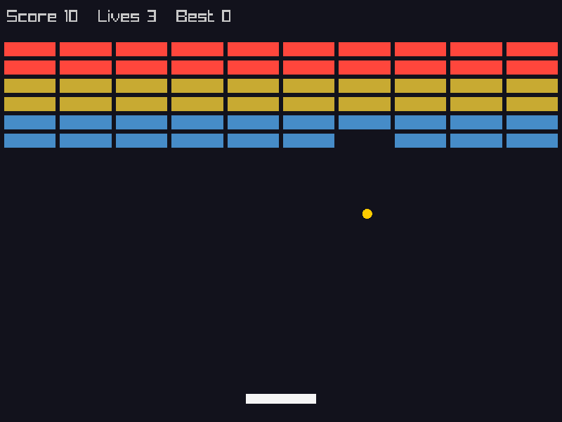
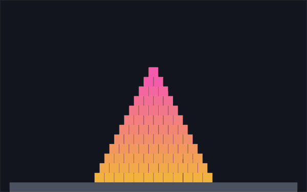
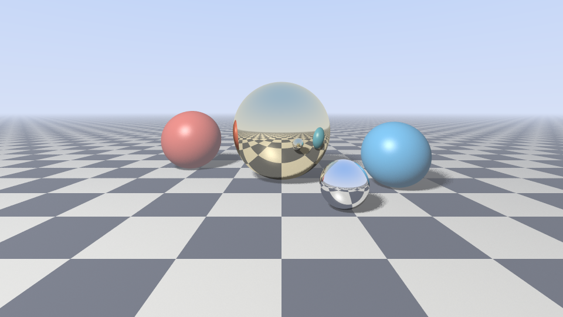
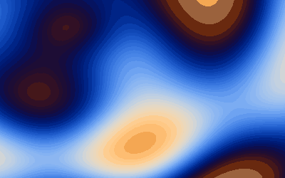
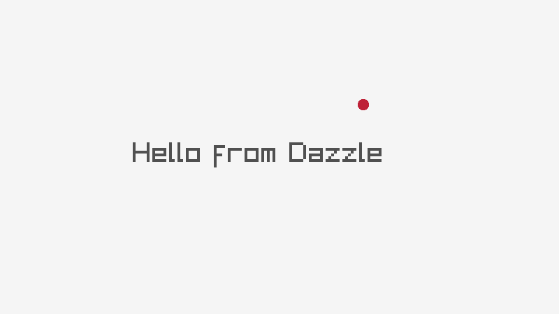

# Examples

Each folder is a complete Dazzle project, and most use a different C library, built from its
own source by `dz` and called directly, with no bindings or wrappers. Pick the library you want
to work with, copy its folder, and you have a project that already builds.

| | Example | Library | What it is |
|---|---|---|---|
|  | [**breakout**](breakout) | [raylib](https://www.raylib.com) | A complete game: the rules in plain Dazzle, drawn with raylib |
|  | [**sdl3**](sdl3) | [SDL3](https://libsdl.org) | A real-time 3D scene: per-pixel lighting, soft shadows, fog and 400 000 blades of instanced grass in GLSL. A large C library built with no CMake |
|  | [**box2d**](box2d) | [Box2D](https://box2d.org) + [sokol](https://github.com/floooh/sokol) | Rigid-body physics: knock down a pyramid. Two C libraries in one project |
|  | [**sokol**](sokol) | [sokol](https://github.com/floooh/sokol) | A particle fountain with additive blending, on sokol_app, sokol_gfx and sokol_gl |
|  | [**stb**](stb) | [stb_image_write](https://github.com/nothings/stb) | A ray tracer that renders this image on the CPU and saves it as a PNG |
|  | [**rgfw**](rgfw) | [RGFW](https://github.com/ColleagueRiley/RGFW) | A window with a plasma effect computed pixel by pixel, no GPU API |
|  | [**raylib**](raylib) | [raylib](https://www.raylib.com) | The smallest windowed program: sixteen lines |
| 🔊 | [**miniaudio**](miniaudio) | [miniaudio](https://miniaud.io) | A synthesizer: an arpeggio and a bass line, generated sample by sample |
| `>_` | [**ownership**](ownership) | none | A growable array from scratch: `own`, the three special members, copies and moves |

## Running one

The C libraries are git submodules in [`vendor/`](vendor). Clone with `--recursive`, or fetch
them in an existing checkout:

```bash
git submodule update --init
```

Then, from the repository root:

```bash
dz run examples/box2d
```

The first build compiles the library itself, which takes a few seconds for the larger ones;
after that only what changed is rebuilt.

## Using one as a template

1. Copy the folder somewhere of your own.
2. Put the library's source beside it (a git submodule, or a copy), and point the recipe's
   `root` in `dazzle.toml` at it.
3. `dz run .`

The `[cpp.libs.…]` table in each manifest is the whole integration: which files to compile,
with which defines, and which headers Dazzle reads. Each manifest says why every line is
there. [Spec §15](../docs/spec/15-c-interoperability.md) has the rest.

## Any other library

None of these libraries is special to Dazzle. A recipe for a library you choose is written
the same way:

```toml
[dependencies]
lib = { cpp = "mylib" }              # every file writes `lib::Something`

[cpp.libs.mylib]
root         = "vendor/mylib"
sources      = ["src/*.c"]           # or `header = "mylib.h"` for a single-header library
include_dirs = ["include"]
import       = ["mylib.h"]           # what Dazzle code can see
```

Its functions, structs, enums, constants and macros become a Dazzle module, read from the
header by libclang. C++ works the same way, classes and overloaded methods included.
